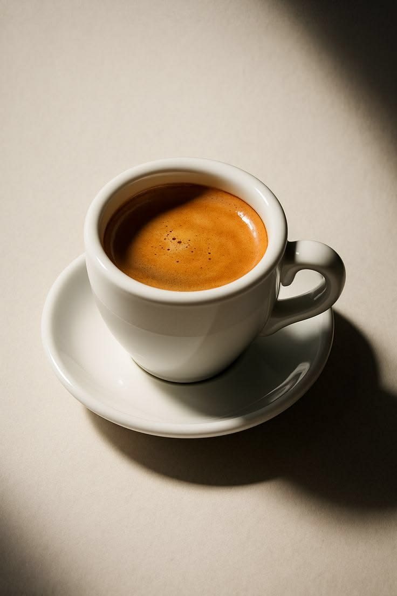
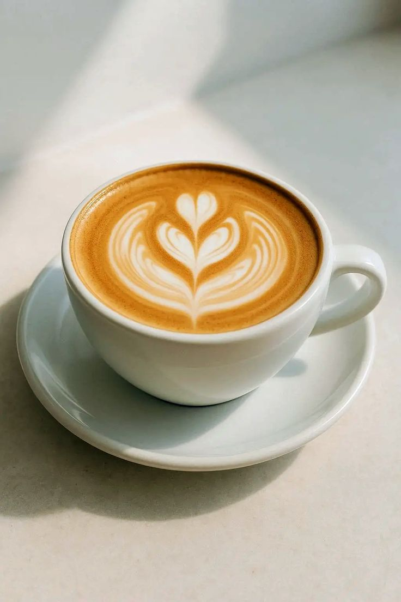

<!-- Customer favourites slideshow -->
<section class="featured-section favourites-section">

    

        
MADE WITH LOVE AT KOFI

        <h2>Our Customers' Favourites</h2>
        

            Discover the drinks and treats our customers love.
            Your next favourite might be waiting here!
        

    

    

        

            <article class="favourite-card">
                

                    
                    Customer Favourite
                

                

                    <h3>Espresso</h3>
                    

                        Rich, bold and full of flavour.
                        Perfect for coffee lovers.
                    

                    <a href="products.html" class="favourite-link">
                        Explore Product →
                    </a>
                

            </article>

            <article class="favourite-card">
                

                    
                    Popular Choice
                

                

                    <h3>Cappuccino</h3>
                    

                        Smooth espresso with steamed milk
                        and a delicious layer of foam.
                    

                    <a href="products.html" class="favourite-link">
                        Explore Product →
                    </a>
                

            </article>

            <article class="favourite-card">
                

                    
                    Freshly Baked
                

                

                    <h3>Fresh Croissant</h3>
                    

                        A golden, buttery pastry that pairs
                        beautifully with your coffee.
                    

                    <a href="products.html" class="favourite-link">
                        Explore Product →
                    </a>
                

            </article>

        

        

            <button type="button"
                    id="previousFavourite"
                    aria-label="Previous favourite">
                &#8592;
            </button>

            

                <button type="button" aria-label="Show favourite 1"
                        class="active"></button>
                <button type="button" aria-label="Show favourite 2"></button>
                <button type="button" aria-label="Show favourite 3"></button>
            

            <button type="button"
                    id="nextFavourite"
                    aria-label="Next favourite">
                &#8594;
            </button>

        

    

    <a href="products.html" class="btn favourites-menu-button">
        View Our Full Menu
    </a>

</section>
